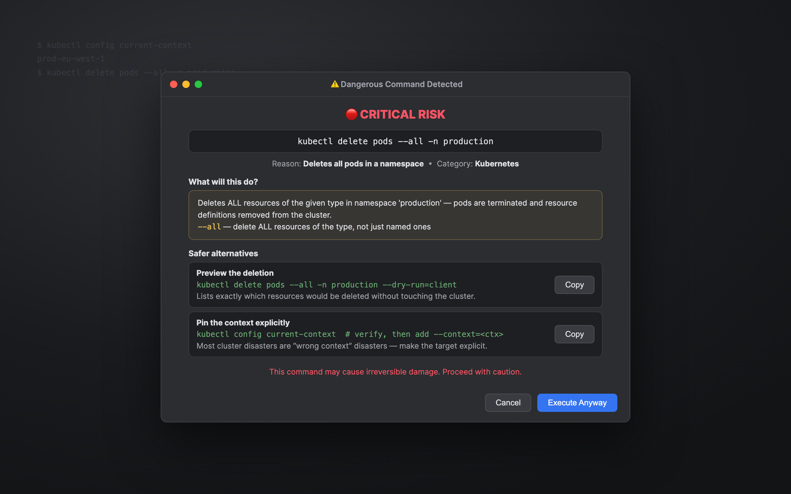
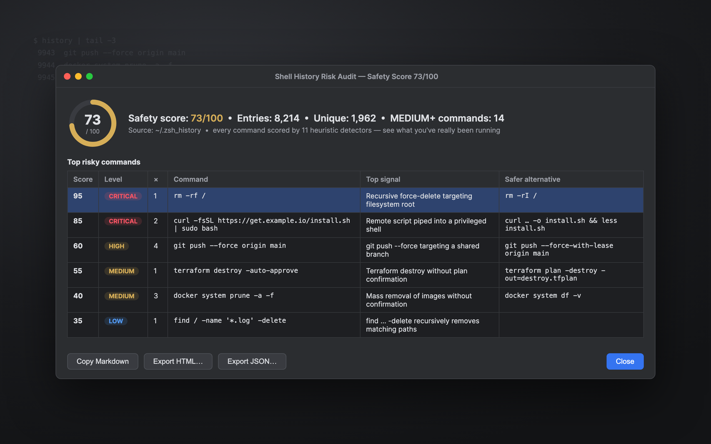
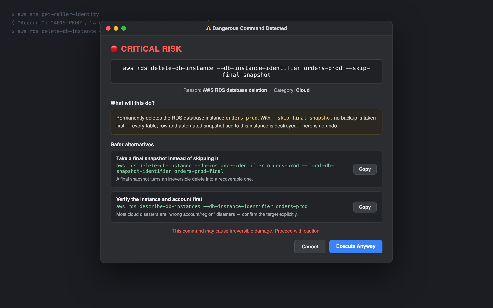
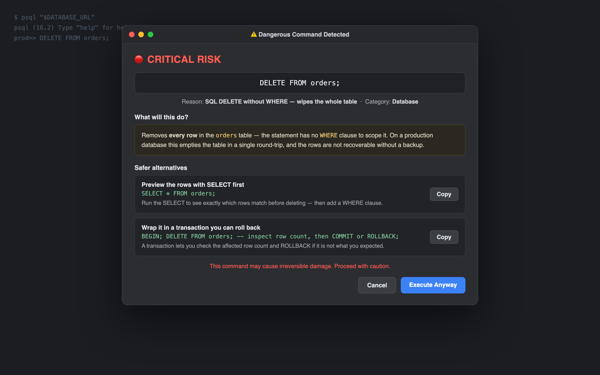
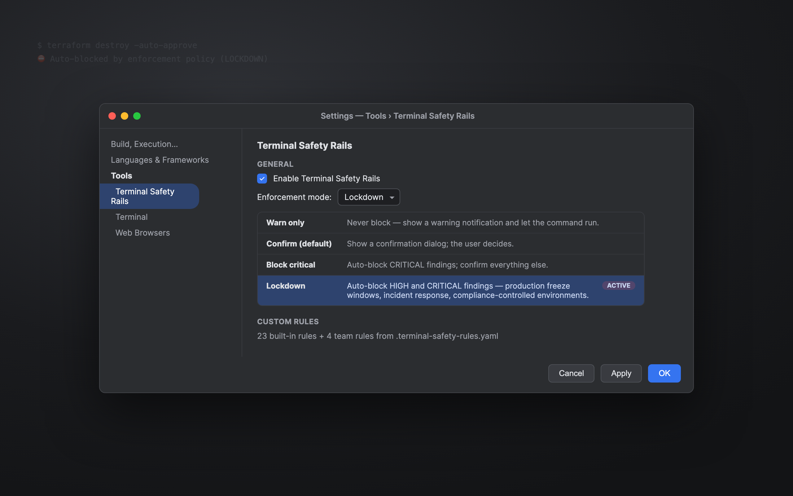
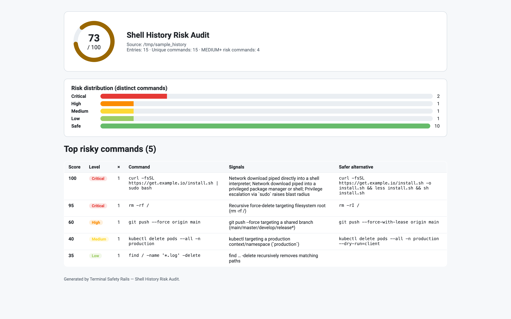
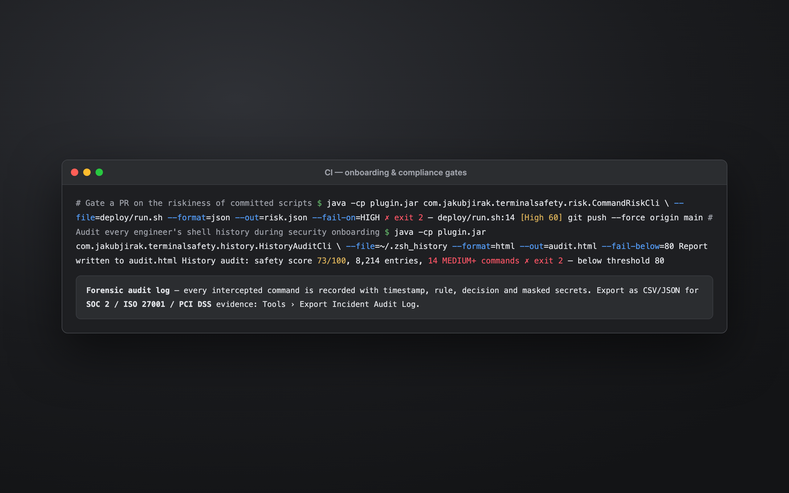

# Terminal Safety Rails

[](https://plugins.jetbrains.com/plugin/30203)
[](LICENSE)
[](https://github.com/JirakJ/terminal-safety-rails/actions/workflows/build.yml)

> Detects dangerous commands in your IDE terminal and shows a confirmation dialog before execution — protecting against accidental `rm -rf`, `kubectl delete`, `terraform destroy`, and more.

## 📸 Screenshots

| Confirmation dialog with explanation & safer alternatives | Shell History Risk Audit |
|---|---|
|  |  |

| Cloud infrastructure protection (AWS / GCP / Azure) | SQL mass-mutation guard (DELETE/UPDATE without WHERE) |
|---|---|
|  |  |

| Enforcement modes (Warn / Confirm / Block critical / Lockdown) | Standalone HTML report |
|---|---|
|  |  |

| CI & compliance gates |
|---|
|  |

## ✨ Features

- **Command interception** — catches dangerous commands before they execute in the IDE terminal
- **4 risk levels** — 🔴 CRITICAL, 🟠 HIGH, 🟡 MEDIUM, 🟢 LOW
- **Color-coded confirmation dialog** — warning with command details and risk level
- **33 built-in rules** — dangerous command patterns out of the box covering filesystem, Kubernetes, Terraform, Docker, AWS/GCP/Azure cloud, Git, SQL, system services, and permissions
- **Unlimited custom rules** — add your own patterns via settings
- **Enable/disable toggle** — quickly turn protection on and off
- **Context-aware detection** — smarter matching based on environment
- **Audit log** — track all intercepted commands with timestamps and actions (ALLOWED/BLOCKED)
- **Team-shared rules** — share rules via `.terminal-safety-rules.yaml` in your project
- **Statistics** — command interception analytics
- **Rule Effectiveness Analytics** — per-rule hit/block/allow counters with CSV export, persisted per project
- **🆕 Safer alternatives** — the dialog suggests copy-pasteable safer equivalents (`--force-with-lease`, dry runs, backups first)
- **🆕 Command explainer** — plain-English "what will this do?" with decoded flags, right in the dialog
- **🆕 Shell History Risk Audit** — score your whole `~/.zsh_history` / `~/.bash_history`, get a 0–100 safety score (MD/JSON/HTML export + CLI)
- **🆕 Enforcement modes** — Warn only / Confirm / Block critical / Lockdown (auto-block HIGH+ for prod-freeze & compliance)
- **🆕 Cloud infrastructure protection** — intercepts destructive AWS/GCP/Azure CLI commands (`aws s3 rb`, `aws ec2 terminate-instances`, `aws rds delete-db-instance`, `gsutil rm -r`, `az group delete`, …)
- **🆕 SQL mass-mutation guard** — flags `DELETE FROM` / `UPDATE … SET` with no `WHERE` clause (statement-scoped; works inside `psql -c` / `mysql -e`)

## 🧭 Enforcement Modes

**Settings → Tools → Terminal Safety Rails → Enforcement mode:**

| Mode | Behaviour |
|---|---|
| **Warn only** | Never blocks — matched commands run and a warning notification is shown. Zero friction, full visibility. |
| **Confirm** *(default)* | The classic confirmation dialog; the user decides. |
| **Block critical** | CRITICAL findings are auto-blocked with no override dialog; everything else asks. |
| **Lockdown** | HIGH and CRITICAL findings are auto-blocked — for production freeze windows, incident response and compliance-controlled machines. |

Auto-blocked and auto-allowed events are recorded in the incident audit log
(`BLOCKED` / `ALLOWED` decisions) and in rule analytics, so every mode stays fully auditable.

## 🕰️ Shell History Risk Audit

**Tools → Audit Shell History Risk** parses your shell history (zsh extended
format, bash with timestamps, plain), scores every distinct command with the
13 heuristic risk detectors and shows a **0–100 safety score**, risk
distribution and the riskiest commands — each with a safer alternative when
one exists. Exports: Markdown, JSON, self-contained HTML.

The same audit runs headless (security onboarding, fleet audits):

```bash
java -cp plugin.jar com.jakubjirak.terminalsafety.history.HistoryAuditCli \
  --file=~/.zsh_history --format=html --out=audit.html --fail-below=80
```

Exit codes: `0` ok, `1` usage/IO error, `2` safety score below `--fail-below`.

## 📊 Rule Effectiveness Analytics

Every time a safety rule matches a command, Terminal Safety Rails records the outcome (allowed, blocked, confirmed-then-allowed, confirmed-then-blocked) in a project-level, persistent store. Open **Tools → Show Rule Effectiveness Analytics** to:

- See which rules actually fire (and which are dead weight you can prune)
- Measure noise — rules with a high confirm-then-allow rate are probably too broad
- Audit your safety posture with the **Export CSV…** button (RFC-4180 escaped)
- Reset counters per-rule or globally

The recorded *last matched command* is automatically sanitised — long hex/base64 tokens, `password=`, `token=`, `-p <value>`, and `Authorization: Bearer …` are replaced with `***` before being stored.

## 🛡️ Incident Audit Log

Security teams demonstrating SOC2 (CC7.2), ISO 27001 (A.12.4), or PCI DSS (10.x) controls need **per-event** forensic evidence of every dangerous-command interception. Terminal Safety Rails writes an append-only, size-rotated JSON Lines audit log at `<project>/.idea/terminal-safety/audit.log.jsonl` (rotated at 10 MiB, last 5 archives retained).

Every match produces a record with:

| CSV Column       | Meaning |
|------------------|---------|
| `eventId`        | UUID v4 unique id for the event |
| `isoTimestamp`   | ISO-8601 UTC timestamp |
| `user`           | Operating-system user that ran the command |
| `host`           | Short host name (cached after first lookup) |
| `projectName`    | Display name of the project |
| `ruleId`         | Stable id of the rule that matched |
| `decision`       | `BLOCKED`, `ALLOWED`, `CONFIRMED_ALLOWED`, `CONFIRMED_BLOCKED`, or `RAN_ANYWAY` |
| `command`        | Command line after secret masking (hex/base64/password/token/api_key/Bearer/`-p`/CC-number) |
| `commandHash`    | SHA-256 hex of the unmasked original for duplicate correlation without storing cleartext |

Open **Tools → Show Incident Audit Log** for a filterable `JBTable` viewer (date range, rule id, decision subset, substring match, row limit) with CSV / JSON export, "Clear Log…", and "Reveal File". For headless CI pipelines, use **Tools → Export Incident Audit Log** — the file extension you choose (`.csv` or `.json`) selects the export format and a notification with row count is shown when the write completes. Writes are dispatched off the EDT via `AppExecutorUtil`, so a noisy terminal never blocks the UI.

## 🧮 Command Risk Scoring & Heuristic Classifier

In addition to the *rule-based* deny/allow engine, Terminal Safety Rails ships a complementary **heuristic scorer** that turns any command into a deterministic `0..100` risk score plus a five-band classification (`SAFE`, `LOW`, `MEDIUM`, `HIGH`, `CRITICAL`). When no explicit rule matches but the score crosses the `HIGH` threshold, the user is presented with a **Risk Alert** dialog that lists every triggered signal — so genuinely novel footguns stop being silent.

| Detector | Example signal | Weight |
|----------|----------------|--------|
| Destructive file ops | `rm -rf /` | 95 |
| Destructive file ops | `--no-preserve-root` | 85 |
| Destructive file ops | `rm -rf ~` / `rm -rf $HOME` | 75 |
| Destructive file ops | `find … -delete` | 35 |
| Privilege escalation | `sudo`, `su -`, `doas`, `pkexec` | 20 |
| Shell injection | `` `cmd` ``, `$(cmd)`, `eval …` | 45 |
| Remote code execution | `curl … \| bash` | 70 |
| Credential exposure | `echo $SECRET`, hard-coded tokens | 40 |
| Network exfiltration | `nc -l`, `/dev/tcp`, reverse shells | 55 |
| Production target | hosts containing `prod`/`production` | 30 |
| Disk wipe | `dd of=/dev/sdX`, `mkfs`, `shred` | 90 |
| Fork bomb | `:(){ :\|:& };:` | 95 |
| Git history rewrite | `push --force`, `filter-branch`, `reset --hard origin/…` | 40 |
| Privileged package manager | `sudo npm -g`, `curl \| sudo apt`, `sudo pip install` | 30–55 |
| Cloud destruction | `aws s3 rb`, `aws rds delete-db-instance`, `az group delete`, `gsutil rm -r` | 55–65 |
| Unscoped SQL mutation | `DELETE FROM t` / `UPDATE t SET …` with no `WHERE` | 55–60 |

Weights are additive and clamped to `0..100`; `sudo rm -rf --no-preserve-root /` therefore always lands at `CRITICAL (100)`, while a lone `sudo apt update` stays in `LOW`.

**Tools → Analyze Command Risk** lets you paste any command and see every triggered signal in a sortable table. **Tools → Show Recent High-Risk Commands** mines the incident audit log for the most recent `HIGH`/`CRITICAL` matches. A headless CLI (`CommandRiskCli`) is available for CI pipelines with `--command` / `--file`, `--format=text|md|json`, `--min-level`, `--out`, and `--fail-on` flags — it exits `0` on clean, `1` on threshold exceeded, `2` on usage error, with atomic output writes suitable for pipelines.

Scoring runs inside a project-level `@Service` with a 30-second cache (256 entries) and defensive per-detector exception isolation, so one bad regex cannot break the engine.

## 📦 Installation

### From JetBrains Marketplace
1. Open **Settings → Plugins → Marketplace**
2. Search for **"Terminal Safety Rails"**
3. Click **Install**

### From ZIP
1. Download the latest release from [Releases](https://github.com/JirakJ/terminal-safety-rails/releases)
2. Open **Settings → Plugins → ⚙️ → Install Plugin from Disk**
3. Select the downloaded ZIP file

## 🚀 Quick Start

1. Install the plugin and restart your IDE
2. Open the built-in IDE terminal
3. Type any dangerous command (e.g., `rm -rf /tmp/*`)
4. A color-coded confirmation dialog appears showing the risk level and matched rule
5. Choose **"Execute Anyway"** to proceed or **"Cancel"** to block the command

## ⚙️ Configuration

**Settings → Tools → Terminal Safety Rails**

| Setting | Default | Description |
|---------|---------|-------------|
| Enable plugin | `true` | Enable or disable command interception |
| Custom rules | *(empty)* | Table of custom command rules (pattern, risk level, category, description, regex toggle) |

### Custom Rule Fields

| Field | Description |
|-------|-------------|
| Pattern | Command pattern to match (glob or regex) |
| Risk Level | `CRITICAL`, `HIGH`, `MEDIUM`, or `LOW` |
| Category | `FILESYSTEM`, `KUBERNETES`, `TERRAFORM`, `DOCKER`, `GIT`, `DATABASE`, `SYSTEM`, `PERMISSIONS`, or `CUSTOM` |
| Description | Human-readable description shown in the confirmation dialog |
| Is Regex | Whether the pattern is a regex (`true`) or glob (`false`) |

## 🎯 Usage

### How Interception Works
1. You type a command in the IDE terminal
2. The `CommandInterceptor` checks the command against all effective rules (custom rules first, then built-in)
3. If a match is found, a modal `DangerousCommandDialog` is displayed
4. The dialog shows the matched command, risk level (color-coded), and rule description
5. You confirm or cancel execution

### Built-in Rules

#### 🔴 CRITICAL
| Pattern | Category | Description |
|---------|----------|-------------|
| `rm -rf /` | Filesystem | Recursive force delete from root |
| `rm -rf ~` | Filesystem | Recursive force delete of home directory |
| `rm -rf *` | Filesystem | Recursive force delete with wildcard |
| `mkfs` | System | Filesystem format command |
| `dd if=` | System | Raw disk write |
| `DROP TABLE` | Database | SQL DROP TABLE |
| `DROP DATABASE` | Database | SQL DROP DATABASE |
| `TRUNCATE` | Database | SQL TRUNCATE |
| `DELETE FROM …;` (no `WHERE`) | Database | Wipes the whole table |
| `aws rds delete-db-instance` | Cloud | AWS RDS database deletion |
| `az group delete` | Cloud | Azure resource-group deletion |

#### 🟠 HIGH
| Pattern | Category | Description |
|---------|----------|-------------|
| `kubectl delete` | Kubernetes | Kubernetes resource deletion |
| `kubectl apply --force` | Kubernetes | Kubernetes force apply |
| `terraform apply` | Terraform | May modify infrastructure |
| `terraform destroy` | Terraform | Removes infrastructure |
| `UPDATE … SET …;` (no `WHERE`) | Database | Rewrites every row |
| `aws s3 rb` / `aws s3 rm --recursive` | Cloud | S3 bucket / recursive object delete |
| `aws ec2 terminate-instances` | Cloud | EC2 instance termination |
| `aws dynamodb delete-table` | Cloud | DynamoDB table deletion |
| `aws cloudformation delete-stack` | Cloud | CloudFormation stack deletion |
| `gsutil rm -r` | Cloud | Recursive Google Cloud Storage delete |

#### 🟡 MEDIUM
| Pattern | Category | Description |
|---------|----------|-------------|
| `docker system prune` | Docker | Removes all unused data |
| `docker rm -f $(docker ps` | Docker | Force remove all containers |
| `git push --force` / `git push -f` | Git | Rewrites remote history |
| `git reset --hard` | Git | Discards all changes |
| `chmod 777` | Permissions | World-writable permissions |
| `systemctl stop` | System | Stopping system service |
| `service ... stop` | System | Stopping system service |

### Team-Shared Rules
Place a `.terminal-safety-rules.yaml` file in your project root to define shared safety rules for your team. Team rules are loaded automatically and merged with built-in and custom rules.

### Team Rule Linter

Validate your team rules file *before* it ships. From **Tools → Lint Team Rules File** (action id `TerminalSafety.LintTeamRules`) or the standalone CLI, the linter catches:

- Invalid regular expressions (reported with the underlying `PatternSyntaxException` description and index).
- Empty / whitespace-only patterns.
- Duplicate rule ids and rules whose synthetic description was never set.
- **Conflicting actions** — two rules with the same pattern but different risk levels.
- **Unreachable rules** — a specific rule shadowed by an earlier broader pattern (heuristic: substring containment, skipping the permissive `LOW` level).
- **Overly broad patterns** — `.*`, `.+`, `^.*$` on non-permissive risk levels.

Results are sorted ERROR → WARNING → INFO and can be copied/exported as a GitHub-flavoured Markdown report with collapsible sections.

#### CI integration example

```yaml
# .github/workflows/rules-lint.yml
name: Lint Team Rules
on:
  pull_request:
    paths: [".terminal-safety-rules.yaml"]
jobs:
  lint:
    runs-on: ubuntu-latest
    steps:
      - uses: actions/checkout@v4
      - uses: actions/setup-java@v4
        with: { distribution: temurin, java-version: "17" }
      - name: Run rule linter
        run: |
          java -cp "path/to/terminal-safety-rails.jar" \
            com.jakubjirak.terminalsafety.lint.RuleLintCli \
            --source=.terminal-safety-rules.yaml \
            --format=markdown \
            --fail-on=error > lint-report.md
      - name: Upload report
        if: always()
        uses: actions/upload-artifact@v4
        with: { name: rules-lint, path: lint-report.md }
```

Exit codes: `0` clean, `1` bad args / missing file, `2` issues at or above the configured `--fail-on` threshold.

### Risk Level Colors
| Level | Color | Hex |
|-------|-------|-----|
| 🔴 CRITICAL | Red | `#E53935` |
| 🟠 HIGH | Orange | `#FB8C00` |
| 🟡 MEDIUM | Yellow | `#FDD835` |
| 🟢 LOW | Green | `#66BB6A` |

## 📋 Requirements

- IntelliJ IDEA 2024.3+ (or any JetBrains IDE based on IntelliJ Platform)
- Java 17+
- Terminal plugin (bundled with JetBrains IDEs)

## 🏗️ Building from Source

```bash
git clone https://github.com/JirakJ/terminal-safety-rails.git
cd terminal-safety-rails
./gradlew build
```

## 🤝 Part of DevOps Safety Kit

Terminal Safety Rails pairs with [Kubernetes Context Guard](https://github.com/JirakJ/kubernetes-context-guard) and [Local Secrets Tripwire](https://github.com/JirakJ/local-secrets-tripwire) for comprehensive protection against accidental production changes and secret leaks.

## 👤 Author

**Jakub Jirák**
- GitHub: [@JirakJ](https://github.com/JirakJ)

## Free & open source

As of version 2026.8.0 this plugin is completely free — every feature is unlocked and no license is needed. The source code is available at https://github.com/JirakJ/terminal-safety-rails under the Apache License 2.0.

## Contributing

Issues and pull requests are welcome — please open them on GitHub.

## License

Copyright 2026 Jakub Jirák. Licensed under the [Apache License, Version 2.0](LICENSE).
